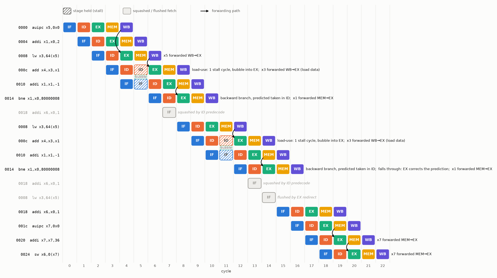
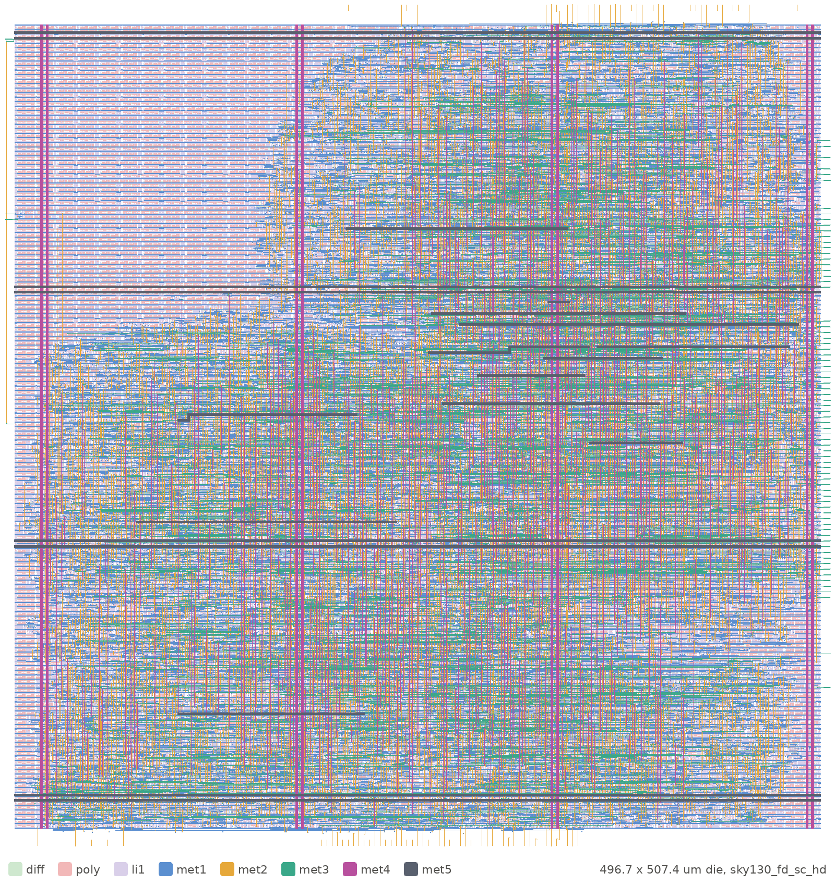
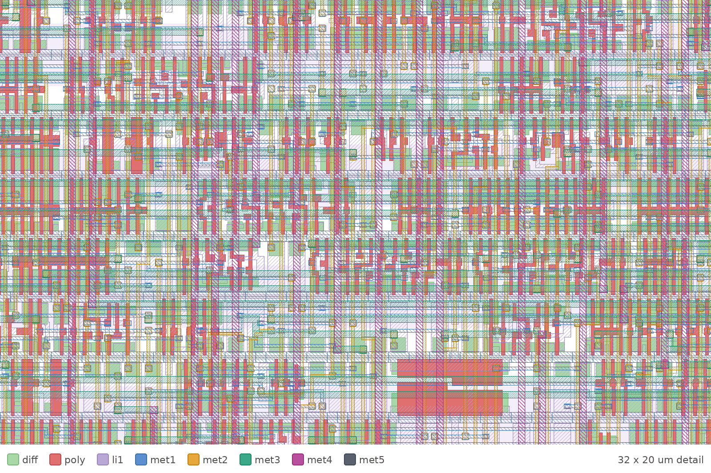

# rv32i-core

A 5-stage pipelined **RV32I + minimal Zicsr / machine-mode trap** core in
synthesizable SystemVerilog. It is verified with riscv-tests and a lock-step
commit-log comparison against **Spike** over more than 10 M constrained-random
instructions, measured on Dhrystone, wrapped in a small APB SoC (UART + timer),
and hardened with **OpenLane2 on SkyWater sky130_fd_sc_hd**.

Author: Maitri Salunke. Every number below was produced by the commands
shown; the logs are under `build/` and `pd/results/`.

## Block diagram

```
                +------------------------------- redirect (taken branch / jump / trap / mret) ----------------------+
                |                                                                                                    |
                v                                                                                                    |
 +------+   imem_addr   +-----------+  insn  +-----------------+       +------------------------------+      +--------+------+      +------------+
 | PC_F |-------------->| I-SRAM    |------->| ID              | ID/EX | EX                           |EX/MEM| MEM           |MEM/WB| WB         |
 | (IF) |  (flop out)   | (sync rd) |        |  decode         |=====> |  fwd muxes -> ALU            |====> | dmem_req/we/  |====> | load align |
 +------+               +-----------+        |  regfile 2R1W   |       |  branch cmp, pc+imm          |      | addr/be/wdata |      | wb mux     |
    ^ +4                 (out reg = IF/ID)    |  (WB bypass)    |       |  st-data align, misalign chk |      |  (flop outs)  |      | rf write   |
    |                                         +-----------------+       |  CSR unit, trap/irq detect   |      +-------+-------+      +-----+------+
    |                                               ^   ^               +------------------------------+              |  D-SRAM / APB         |
    |                                               |   |                  ^ fwd from MEM      ^ fwd from WB          v  (gnt, rdata @ +1)    |
    |                                               |   +------------------+-------------------+-----------------------------------------------+
    |                                               +---- regfile write (WB) -----------------------------------------------------------------+
    |
  hazard unit: fwd_a/fwd_b select, load-use stall (IF/ID hold + EX bubble), redirect flush (ID + fetch), dmem back-pressure freeze
  ID predecode: JAL / backward branch -> pc_f <= id_pc + imm, squash the pc+4 fetch (EX corrects mispredictions)

 SoC (rtl/soc/soc_top.sv):
   rv32i_core --imem--> I-RAM 64 KiB @0x8000_0000
              --dmem--> decode --> D-RAM 64 KiB @0x8000_0000
                                \-> apb_bridge --APB--> apb_uart  @0x1000_0000 (txd/rxd, irq)
                                                    \-> apb_timer @0x1000_1000 (irq -> mip.MTIP)
```

## Pipeline and hazards in brief

| Stage | Work |
|---|---|
| IF | `pc_f` drives the synchronous instruction SRAM directly; the SRAM's output register is the IF/ID instruction register |
| ID | decode, register-file read (31x32 flops, write-first bypass from WB), **static branch predecode**: JAL and backward branches redirect fetch to `pc+imm` |
| EX | forwarding muxes, ALU, branch compare and target, store-data alignment, misalignment checks, CSR read/write, exception/interrupt detection; **mispredictions, JALR, traps and `mret` redirect from here** |
| MEM | data-bus request from EX/MEM flops; `dmem_gnt=0` freezes IF..MEM |
| WB | load align/sign-extend, register-file write, `minstret` retire |

* **Forwarding:** EX/MEM->EX and MEM/WB->EX (including load data), MEM first;
  WB->ID through the register-file bypass.
* **Load-use:** 1-cycle stall plus EX bubble when the next instruction uses the
  load's `rd` (rs1/rs2 "used" bits avoid false stalls).
* **Control:** static BTFN predecode in ID. JAL and backward conditional
  branches are predicted taken and redirect fetch from ID (1 cycle: the
  `pc+4` fetch is squashed); forward branches are predicted not-taken. EX
  stays the correction path: a mispredicted branch, any JALR, a trap or
  `mret` costs 2 cycles (ID + fetch flushed). No register read or compare
  moved into ID, so no forwarding into ID.
* **Back-pressure:** IF..MEM freeze, WB bubble; ID/EX latches forwarded
  operands while frozen so a retiring WB producer is not lost.
* **Traps:** precise, taken in EX. Supports ECALL, EBREAK, illegal instruction
  / unimplemented CSR, load/store/fetch misaligned, and the machine timer
  interrupt; `mepc`/`mcause`/`mtval`/`mstatus.MIE/MPIE` and `mret`.



*Stage occupancy per cycle for `sw/pipe_demo/pipe_demo.S`, taken from the Verilator model (`+pipetrace=`, drawn by `scripts/pipeview.py`).*

The full explanation is in [docs/DESIGN.md](docs/DESIGN.md). Defects found are in
[docs/BUGS.md](docs/BUGS.md).

## Results

### Functional verification

| What | Result | How (command / log) |
|---|---|---|
| Lint | Verilator `-Wall` clean, core and SoC | `make lint` |
| riscv-tests `rv32ui-p` | **40/40 run pass; 40/42 of the suite** | `make test-isa`, `build/isa/results_stall0.txt` |
| riscv-tests `rv32mi-p` | **14/14 run pass; 14/16 of the suite** | same |
| same, with 30% random `dmem_gnt` back-pressure | 40/40 and 14/14 | `build/isa/results_stall30.txt` |
| riscv-tests commit log vs Spike | 52/54 logs identical (16,579 retired instructions). The 2 differences are implementation-defined CSRs: Spike implements `mcountinhibit` (instret_overflow) and reports `marchid=5` (mcsr) | `run_isa.py --spike` |
| Random programs vs Spike | **200 programs, 10,776,489 retired instructions compared, 0 mismatches**; 66 of the 200 programs (seeds divisible by 3) ran with 25% back-pressure | `make test-random N=200 SEED=1`, `build/random/summary.txt` |
| Hazard events in that campaign (RTL counters) | 1,149,099 load-use stalls, 2,348,786 MEM->EX and 1,424,141 WB->EX forwards, 903,775 taken branches/jumps (542,800 redirected from ID; 598,735 EX control redirects incl. 177,560 JALR), 179,040 traps, 337,826 back-pressure stall cycles, 10,819 forwards held across a stall | same log |
| Random programs vs Spike, **branch-heavy mix** | **200 programs, 10,945,271 retired instructions compared, 0 mismatches** (1,797,573 taken branches/jumps, 1,655,575 ID redirects, 924,871 EX control redirects, 162,745 traps) | `make test-random N=200 SEED=1001 MIX=branch` |
| Mutation check (8 injected bugs: 5 hazard + 3 predecode/mispredict) | all 8 detected (`no_operand_capture_on_mem_stall` 2/6 programs, every other mutant 6/6) | `make mutation`, `build/mutation/summary.txt` |
| Hazard bugs found in the RTL by this flow | **0** (see `docs/BUGS.md`; the defects that were found were in tooling, testbench and test software) | |
| SoC smoke test | PASS: 102 UART characters decoded from `txd`, 4/4 loopback bytes, 5 timer interrupts | `make test-soc` |

Excluded tests (each confirmed by running it and reading its source):
`rv32ui/fence_i` (self-modifying code; no Zifencei, Harvard memories),
`rv32ui/ma_data` (requires hardware misaligned access; the core traps),
`rv32mi/breakpoint` (assumes Sdtrig `tselect`/`tdata`),
`rv32mi/pmpaddr` (assumes PMP). `rv32mi/csr`, `illegal`,
`instret_overflow` and `zicntr` detect the missing U/S-mode and optional
features themselves and pass.

### Performance (Dhrystone 2.2)

| | CPI (timed loop, `mcycle`/`minstret`) | DMIPS/MHz | control-flow bubbles / instr | load-use / instr |
|---|---|---|---|---|
| **current** (ID predecode, BTFN) | **1.266** (1,448,025 cycles / 1,144,021 instr) | **0.786** (1381.2 Dhrystones/s/MHz) | **0.234** = 0.137 ID redirects (1 cycle) + 0.097 EX redirects (2 cycles) | 0.044 |
| history: predict not-taken, all redirects from EX | 1.374 (1,572,023 / 1,144,021) | 0.724 (1272.2) | 0.336 (2 cycles per taken branch/jump) | 0.044 |

Breakdown (whole program, testbench counters, `build/cpi.txt`): 199,653
taken branches/jumps; 163,000 handled in ID at 1 cycle; 57,679 EX
redirects at 2 cycles, of which 34,219 are JALR (mostly `ret`, 0.058
cycles/instr) and 23,460 are JAL/branch mispredictions (0.039 cycles/instr,
17% of the remaining control-flow bubbles). The instruction count is
unchanged; the 8% CPI reduction is entirely fewer bubbles. Conditions:
`gcc 16.2 -O2 -march=rv32i_zicsr`, multiply/divide through libgcc (no M
extension), ideal 1-cycle memories; Dhrystone's own "should be" checks all
match. `make cpi`. What remains is returns (JALR, needs a RAS or BTB),
forward-taken branches and load-use.

### Physical design (OpenLane2 2.3.10, sky130A `sky130_fd_sc_hd`, core only)

Setup: `rv32i_core` alone with the register file in flops; the memories are
outside, modelled by OpenLane's default I/O constraints (4 ns input and output
delay = 20% of a 20 ns clock, 0.25 ns clock uncertainty, 5% derate).
Fmax = 1/(T - WNS) for the given corner at the constrained period T. Four
runs, all at T = 20 ns with the same floorplan settings (`FP_CORE_UTIL=45`,
`PL_TARGET_DENSITY_PCT=55`). `pred` is the current RTL (ID branch predecode)
with exactly the `final` config (`config_final.json`, incl. antenna repair);
the first three columns are history:

| | `base` (original RTL) | `fix` (timing fix) | `final` (fix + antenna repair) | **`pred`** (final + ID predecode, current) |
|---|---|---|---|---|
| **tt** (nom_tt_025C_1v80) setup WNS / TNS | +3.873 / 0.000 ns | **+6.550 / 0.000 ns** | +5.747 / 0.000 ns | +6.193 / 0.000 ns |
| tt Fmax | 62.0 MHz | **74.3 MHz** | 70.2 MHz | 72.4 MHz |
| **ss** (nom_ss_100C_1v60) setup WNS / TNS | -3.234 / -118.49 ns | **-2.484** / -524.43 ns | -4.115 / -971.74 ns | -3.196 / -588.86 ns |
| ss Fmax | 43.0 MHz | **44.5 MHz** | 41.5 MHz | 43.1 MHz |
| ff (nom_ff_n40C_1v95) setup WNS | +6.789 ns | +9.460 ns | +9.292 ns | +9.467 ns (94.9 MHz) |
| hold WNS, worst corner / hold violations | +0.111 ns (min_ff) / 0 | +0.114 ns (min_ff) / 0 | +0.091 ns (max_ff) / 0 | +0.110 ns (min_ff) / 0 |
| die / core area | 247,672 / 230,341 um^2 | 245,432 / 229,240 um^2 | 245,432 / 229,240 um^2 | 252,046 / 234,963 um^2 |
| std-cell area / utilization | 128,702 um^2 / 55.9% | 127,283 um^2 / 55.5% | 151,747 um^2 / 66.2% | 155,488 um^2 / 66.2% |
| logic cells (no fill/tap/diode), of which flops | 11,166 / 1,627 | 11,052 / 1,627 | 11,052 / 1,627 (+9,970 diodes) | 11,355 / 1,628 (+10,368 diodes) |
| Magic DRC / KLayout DRC / LVS errors | 0 / 0 / 0 | 0 / 0 / 0 | **0 / 0 / 0** | **0 / 0 / 0** |
| antenna violating nets | 28 | 29 | **0** | 2 (ratio 1.17 and 1.10, met3/met1) |
| max-slew violations (worst corner, max_ss) / at nom_tt | 226 / 0 | 373 / 30 | 962 / 90 | 1,043 / 50 |
| max-cap violations (worst corner) | 1 | 3 | 6 | 12 |

Full reports: `pd/results/{base,fix,final,pred}/` (`summary.md`, `metrics.json`,
post-route `max.rpt` at tt and ss). One more run, `pd/results/signoff23/`
(T = 23 ns with the resizer also targeting the ss corner), was *worse*
(ss -4.269 ns at 23 ns, 796 slew violations) and is kept only for the record.



*Final GDSII of the `pred` run (current RTL), rendered with KLayout; 496.7 x 507.4 um die.*



*A 32 x 20 um window of the same layout: standard cells (diff, poly, li1) under met1-met5 routing.*

**Not signed off.** No run meets setup at the ss corner at 20 ns, and the
max-slew/max-cap violations (mostly at ss, introduced largely by the
diode insertion in `final`), and the 2 marginal antenna nets in `pred`, are open. On the evidence above, the design
closes tt at 70-74 MHz and ss at about 41-44 MHz (current RTL: 72.4 / 43.1 MHz); I have not claimed a
clean all-corner signoff.

#### Critical path and the timing fix

* **Before** (`base`, worst at both tt and ss): input `dmem_rdata` (4 ns
  external delay) -> load byte/half alignment -> WB result mux -> forwarding
  mux -> branch comparator -> `redirect` -> `load_use` (which was gated by
  `~redirect`) -> `stall_id` -> output `imem_en` (4 ns external delay).
  This is a combinational memory-in to memory-out path through the
  pipeline's *latest* signal, so both I/O budgets are charged to it.
* **Fix** (`pd/results/timing_fix.diff`, functionally re-verified with the
  full regression above): `load_use` no longer depends on `redirect`. Every
  consumer of `load_use`/`stall_id` (PC update, IF/ID, ID/EX valid) already
  gives `redirect` priority, so the gate was redundant. In addition, the
  ID/EX *data* fields now load whenever the pipe is not frozen; only
  `ex_valid` sees flush/interlock, which takes `redirect`/`load_use` off about
  150 flop enables.
* **Result** at the same 20 ns constraint: tt WNS **+3.873 -> +6.550 ns
  (+2.68 ns; Fmax 62.0 -> 74.3 MHz)**, ss WNS **-3.234 -> -2.484 ns
  (+0.75 ns; 43.0 -> 44.5 MHz)**. ss **TNS got worse** (-118.5 -> -524.4 ns):
  with the dominant path removed, many more endpoints now sit just behind the
  new limit.
* **After** (`fix`/`final`): at tt, `dmem_rdata` -> load alignment -> forward
  -> CSR write data -> `u_csr.mcycle[13]`; at ss, reg-to-reg from
  `wb_is_load` (the select of the 32-bit WB mux, high fanout) -> forward ->
  ALU/CSR -> `mcycle`/`mtval` flops. Next candidates are buffering or
  duplicating `wb_is_load`, and removing the load-data -> CSR write-data path.
* **`pred`** (current RTL): the predecode added 303 logic cells (+2.7%) and 1
  flop (`ex_pred`); the extra adder/mux area also grew the die by 2.7%
  because `FP_CORE_UTIL` sizes it from the synthesized area. Timing did not
  get worse: tt +6.193 ns (72.4 MHz, vs 70.2 for `final`), ss -3.196 ns (43.1
  MHz, vs 41.5). I read that as "no regression" rather than a speed-up; it is
  within the run-to-run placement variation seen between `fix` and `final`.
  The worst path at both corners now ends at `pc_f[31]` (the next-PC mux)
  instead of `mcycle`: tt starts at `dmem_rdata[19]`, ss at `wb_is_load`, and
  both run through load alignment and forwarding into the EX redirect, i.e.
  the existing EX path, not the new ID adder (which starts at `imem_rdata`).
  **Worse than `final`:** 2 nets are slightly over the antenna ratio (1.17x
  and 1.10x of the limit) after the same 10 repair iterations, and max-slew
  (1,043 at max_ss) and max-cap (12) violations increased. I did not do a
  second run to chase them.

## Commands

```sh
make lint                 # Verilator -Wall, core + SoC: clean
make test-isa             # riscv-tests (+ Spike diff), then again with 30% dmem back-pressure
make test-random N=200    # N random programs, lock-step vs Spike (every 3rd with 25% back-pressure)
make cpi                  # Dhrystone CPI from mcycle/minstret
make test-soc             # SoC: APB UART print + loopback, APB timer interrupts
make mutation             # inject 8 hazard/predecode bugs, confirm the random flow catches each
make pd                   # OpenLane2 2.3.10 (Docker) RTL-to-GDS of rv32i_core; see pd/
```

Tool versions used: Verilator 5.054, riscv64-elf-gcc 16.2.0
(`-march=rv32i_zicsr -mabi=ilp32`), Spike built from
`riscv-software-src/riscv-isa-sim` at `e53c8cc`, riscv-tests at `3df703c`,
Yosys 0.71 (local syntax check), OpenLane2 2.3.10 Docker image (arm64).
Tool paths default to `../tools/` (`TOOLS=`, `SPIKE=`, `RISCV_TESTS=`
override them).

## Repository layout

```
rtl/core/   rv32i_core, decode, alu, regfile, csr, hazard, rv32i_defs.svh
rtl/soc/    soc_top, apb_bridge, apb_timer, soc_ram, uart/ (copied, see below)
tb/         tb_core (Verilator), rv_tracer (Spike-format retire trace), tb_soc
sw/         crt0 + mini libc, Dhrystone (from riscv-tests), SoC test
scripts/    elf2hex, run_isa, gen_random, run_random, cmp_commit, cpi, mutation
pd/         OpenLane2 config, Makefile, metrics extraction, results/
docs/       DESIGN.md, BUGS.md
```

## Third-party and copied code

* `rtl/soc/uart/` (`apb_uart.sv`, `uart_tx.sv`, `uart_rx.sv`, `uart_fifo.sv`,
  `uart_baud_gen.sv`) was copied unmodified from the sibling project
  `../apb-uart-uvm/rtl/` (APB UART, also by Maitri Salunke, verified there
  with its own UVM environment). Its `READY` note is kept next to it. It is
  instantiated with `WAIT_STATES=1`, so every UART access also exercises the
  bridge's PREADY wait-state path.
* `sw/dhrystone/` comes from `riscv-tests/benchmarks/dhrystone`
  (`LICENSE.riscv-tests`). The only change is an `#ifndef` guard around
  `NUMBER_OF_RUNS`; `util.h` is a local replacement.
* riscv-tests and Spike are used as external tools, not vendored.

## Known limitations

* No M extension. Dhrystone multiplies and divides through libgcc soft routines.
* M-mode only: no U/S mode, no PMP, no debug triggers, no FENCE.I.
* Misaligned loads and stores trap; they are not emulated in hardware.
* APB `PSLVERR` is recorded by the bridge but does not raise an access-fault
  exception.
